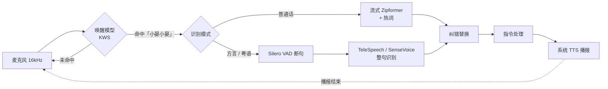

# 小晏助手 · 离线 Android 语音助手

基于 [sherpa-onnx](https://github.com/k2-fsa/sherpa-onnx) 的端侧语音助手。说「小晏小晏」唤醒，然后说指令，识别结果在手机本地生成。**唤醒和识别全程离线**，App 没有申请网络权限，录音不会离开手机。

## 当前能力

| 能力 | 说明 |
|---|---|
| 自定义语音唤醒 | 默认唤醒词「小晏小晏」，可改成任意中文词，支持同时配置多个 |
| 普通话流式识别 | 边说边出字，说完停顿后自动断句 |
| 方言识别 | TeleSpeech：川、粤、闽、吴、湘等 30 多种方言；SenseVoice：粤语、普通话、英、日、韩，自动识别语种 |
| 关键词识别调优 | 热词加权（普通话模式）、识别结果纠错替换（所有模式）、唤醒阈值/增强分实时可调 |
| 本地指令 | 开关手电筒、调音量、报时间、报日期、自我介绍；其余内容原样复述 |
| 语音回复 | 调用系统 TTS 播报，播报期间暂停收音，防止自己唤醒自己 |
| 后台常驻 | 前台服务 + WakeLock，退到后台或息屏后仍能唤醒 |
| 调试工具 | 实时电平、识别文本、运行日志、唤醒计数、唤醒测试模式，每条指令自动保存录音 |

## 运行环境

### 最低配置

| 项目 | 要求 |
|---|---|
| 系统 | Android 8.0（API 26）及以上 |
| CPU 架构 | arm64-v8a（APK 只打包了 64 位 ARM 库） |
| 存储 | 只用普通话约 200 MB；四个模型全装约 770 MB |
| 内存 | 建议 4 GB 及以上（见下方说明） |
| 麦克风 | 手机自带麦克风即可，16 kHz 单声道采集 |
| 网络 | 不需要（下载模型时除外） |
| GPU / NPU | 不需要，纯 CPU 推理 |

> **内存说明**：同一时刻只加载「唤醒模型 + 当前模式的一个识别模型」。int8 模型在内存里的占用大致等于文件大小加上推理时的缓冲区：普通话模式约 200 至 300 MB，TeleSpeech 模式约 400 MB。这是根据模型体积估算的，尚未在设备上实测。

### 已验证设备

| 设备 | SoC | 系统 | 结果 |
|---|---|---|---|
| OnePlus 7 Pro（GM1910） | 骁龙 855 | Android 12 / ColorOS | 全部功能可用 |

该设备上的实测耗时：

| 环节 | 耗时 |
|---|---|
| 加载唤醒模型 | 约 0.2 s |
| 加载普通话流式模型 | 约 4.7 s |
| 加载 TeleSpeech | 约 1.3 s |
| 加载 SenseVoice | 约 1.5 s |
| 方言模式整句解码（2 至 3 秒语音） | 约 0.2 s |

### 开发环境

- JDK 17 及以上（Android Studio 自带的 JBR 即可）
- Android SDK：compileSdk 35
- Gradle 9.3.1（仓库里带了 wrapper）、Android Gradle Plugin 9.0.0
- `adb`、`curl`、`tar`：推送模型时使用
- Python 3 + `pypinyin`：只有重新生成拼音表时才需要

## 使用的模型

模型全部来自 sherpa-onnx 官方发布页，均为 int8 量化版本。为了方便替换和调参，**模型不打进 APK**，而是推送到手机的 `/sdcard/Android/data/com.xiaoyan.assistant/files/models/` 目录。

| 用途 | 模型 | 大小 | 结构 |
|---|---|---|---|
| 语音唤醒 | `sherpa-onnx-kws-zipformer-wenetspeech-3.3M-2024-01-01-mobile` | 约 5 MB | Zipformer transducer，3.3M 参数，拼音声韵母建模 |
| 普通话流式识别 | `sherpa-onnx-streaming-zipformer-zh-int8-2025-06-30` | 约 167 MB | 流式 Zipformer transducer（multi-zh-hans 数据训练），按字建模 |
| 方言识别 | `sherpa-onnx-telespeech-ctc-int8-zh-2024-06-04` | 约 341 MB | 中国电信 TeleSpeech，CTC，覆盖 30 多种方言 |
| 粤语 / 多语种 | `sherpa-onnx-sense-voice-zh-en-ja-ko-yue-int8-2025-09-09` | 约 237 MB | 阿里 SenseVoice-Small，非自回归，自带语种识别和 ITN |
| 语音活动检测 | `silero_vad.onnx` | 0.6 MB | Silero VAD |
| 推理运行时 | `sherpa-onnx-1.13.8.aar` | 48 MB | 自带 ONNX Runtime 和 JNI 库（已放在 `app/libs/`） |

## 快速开始

```bash
# 1. 编译
./gradlew assembleDebug

# 2. 安装（部分 ColorOS / MIUI 机型需要在手机上点「继续安装」）
adb install -r app/build/outputs/apk/debug/app-debug.apk

# 3. 下载并推送模型（首次会下载到 ~/sherpa-dl，之后复用）
tools/push_models.sh                 # 全部模型
tools/push_models.sh kws vad asr     # 只装唤醒 + 普通话
```

`push_models.sh` 支持的模型组有 `kws`、`asr`、`tele`、`sensevoice`、`vad`。如果要换下载目录，设置环境变量 `MODEL_CACHE`。

4. 打开 App，录音权限选「**使用应用时允许**」（选「仅本次允许」的话，退到后台后权限会被收回）。
5. 选择识别模式，点「保存并(重)启动」。顶部状态变绿后，说「小晏小晏」，听到提示音后再说指令。

> 想长期在后台待机的话，在系统电池设置里把小晏助手设为「允许后台运行」，否则国产 ROM 可能会杀掉服务。

## 修改唤醒词

在 App 的「语音唤醒」一栏编辑唤醒词，每行一个，点「保存并(重)启动」立即生效。写法如下：

```text
小晏小晏 :2.0 #0.20
你好小晏
x iǎo y àn t óng x ué @小晏同学
```

| 写法 | 含义 |
|---|---|
| `小晏小晏` | 直接写汉字，App 用内置拼音表转成模型 token：`x iǎo y àn x iǎo y àn` |
| `:2.0` | 这个词的增强分（boosting score），越大越容易唤醒 |
| `#0.20` | 这个词的触发阈值，越小越容易唤醒 |
| `@小晏同学` | 唤醒后日志里显示的名字 |
| 直接写 token | 遇到多音字读错时，用「声母 + 带调韵母」手动指定，token 之间用空格分隔 |

**选词建议**

- 用 3 到 4 个音节，叠词（如「小晏小晏」）效果最好。音节太少容易误唤醒，太多则不好念。
- 避开日常高频词，比如「你好」「我们」。
- 和唤醒词读音完全相同的词也会触发，例如「小雁小雁」和「小晏小晏」都读 xiǎo yàn。这在声学上无法区分。
- 保存后先查看日志。如果某个字查不到拼音，或者 token 不在模型词表里，日志里会给出 ⚠ 提示，这一行唤醒词会被跳过。

**全局参数**

| 参数 | 默认值 | 调大 | 调小 |
|---|---|---|---|
| 全局唤醒阈值 | 0.25 | 更难唤醒，误唤醒更少 | 更容易唤醒，误唤醒变多 |
| 全局增强分 | 1.5 | 更容易唤醒 | 更难唤醒 |
| 尾随 blank 帧数 | 1 | 更稳，不容易被前半截误触发，响应稍慢 | 响应更快 |

每行唤醒词上单独写的 `:分数` 和 `#阈值` 会覆盖全局值。

**调参方法**：勾选「唤醒测试模式」，此时只统计唤醒次数，不进入识别。

1. 正常说 20 次唤醒词，统计唤醒率。
2. 再放一段日常对话或电视声，统计误唤醒次数。
3. 根据结果调整阈值和增强分，重复测试。

## 关键词识别调优

### 热词（只对普通话流式模式生效）

每行一个热词，可以单独加分：

```text
打开手电 :2.0
音量调大
现在几点
```

识别时，解码器会提高这些词的路径得分，让它们更容易被识别出来。全局热词分数默认 1.5。调得过大会让模型把不相干的话也识别成热词，建议在 1.5 到 3.0 之间试。

注意：模型词表外的生僻字（比如「筒」）不能当热词，因为模型输出这类字时是按 UTF-8 字节拼出来的。含这类字的热词会被跳过，日志会提示。可以去掉这类字，只保留其余部分，比如把「手电筒」写成「手电」。

### 纠错替换（所有模式都生效）

每行一条 `错=>对`，在识别结果出来后做字符串替换：

```text
小燕=>小晏
大开=>打开
```

方言模型不支持热词，固定的错字可以靠这里修正。

### 其他识别参数

| 参数 | 默认值 | 作用 |
|---|---|---|
| 识别模式 | 普通话·流式 | 三种模式里选一种 |
| SenseVoice 语种 | auto | 可选 auto / zh / yue / en / ja / ko，固定语种比 auto 更稳 |
| 句尾静音判定 | 0.8 s | 停顿多久算一句话说完 |
| VAD 阈值 | 0.3 | 方言模式用，越小越灵敏；离手机远、说话小声时调低 |
| 唤醒后无语音超时 | 6 s | 唤醒后一直不说话，多久后回到待唤醒 |
| 识别线程数 | 2 | 线程越多越快，也越耗电 |

## 实现原理

### 整体流程



所有逻辑跑在一个后台线程上，用一条麦克风流驱动一个状态机：

```
IDLE（等待唤醒）──唤醒词命中──▶ LISTENING（聆听指令）──断句──▶ RECOGNIZING（识别）──▶ 执行指令 ──▶ IDLE
```

麦克风每次读取 512 个采样点（32 ms）。在 IDLE 状态下，这些数据只送给唤醒模型；进入 LISTENING 后，改送给识别模型。

### 语音唤醒

唤醒模型是一个很小的流式 transducer，输出单位是拼音的声母和带调韵母（比如 `x`、`iǎo`）。

1. **词转 token**：App 内置一张约 2 万字的拼音表（`assets/pinyin_table.txt`），把「小晏小晏」转成 `x iǎo y àn x iǎo y àn`。切分规则和 sherpa-onnx 的 `text2token` 工具一致。
2. **受限搜索**：sherpa-onnx 用所有唤醒词的 token 序列建一张 Aho-Corasick 匹配图。解码时只沿这张图搜索，而不是做通用识别，所以模型只有 3.3M 参数，CPU 占用很低，适合常驻。
3. **触发判定**：
   - 匹配路径上的 token 会加上「增强分」，让唤醒词更容易胜出。
   - 整条路径的平均概率要超过「阈值」才算命中。
   - 命中之后还要再等若干个 blank 帧（「尾随 blank」）才最终触发，防止只说了前半截就被唤醒。

### 普通话流式识别

- **流式解码**：模型是分块（chunk）处理的流式 Zipformer transducer。音频一边送进来一边解码，所以能边说边出字。
- **断句**：由端点检测规则决定，满足任一条即结束：
  - 唤醒后一直没说话，超过超时时间；
  - 说过话之后，静音超过「句尾静音判定」的时长；
  - 一句话超过 15 秒。
- **热词**：只在 `modified_beam_search` 解码方式下生效。热词同样被编成 Aho-Corasick 图，beam search 每走到热词路径上就加分（上下文偏置，contextual biasing）。如果中途偏离了热词，已经加的分会扣回去，避免误伤。模型按字建模，所以热词用 `cjkchar` 方式切成单字。

### 方言 / 粤语识别

TeleSpeech 和 SenseVoice 都是非流式模型，要拿到一整句话再识别：

1. **断句**：唤醒后，音频送入 Silero VAD 判断是否有人在说话。检测到说话、并且之后静音超过「句尾静音判定」，就算一句话结束。
2. **补回句首**：VAD 确认「开始说话」通常要比实际晚 0.4 到 0.8 秒。所以识别时不直接用 VAD 切出的片段，而是从检测点往前多取 1 秒音频，避免吞掉句首的字（比如粤语里鼻音开头的「唔该」）。
3. **整句识别**：
   - TeleSpeech 是 CTC 模型，在大量方言数据上训练。
   - SenseVoice 是非自回归 encoder，会同时输出文字、语种标签（如 `<|yue|>`）和逆文本规范化结果（把「两点」写成「2点」这类处理），速度很快。

### 防止自己唤醒自己

TTS 播报开始时，置一个全局标记，引擎丢弃这段时间的麦克风数据。播报结束后，先清空唤醒模型的状态，再恢复监听。代价是播报期间不能打断（不支持 barge-in）。

### 代码结构

| 文件 | 职责 |
|---|---|
| `AssistantEngine.kt` | 核心：录音、状态机、模型加载、唤醒和识别调度、录音保存 |
| `AssistantService.kt` | 前台服务，承载引擎，保持后台监听 |
| `TextPrep.kt` | 唤醒词转拼音 token、热词校验、纠错规则 |
| `CommandHandler.kt` | 指令匹配和 TTS 回复；要接大模型或其他业务逻辑，改这里 |
| `AppSettings.kt` | 所有可调参数及默认值 |
| `ModelPaths.kt` | 模型文件路径；换模型时改这里 |
| `MainActivity.kt` | 调试界面（纯代码布局，不依赖 AndroidX） |
| `AssistantBus.kt` | 引擎到界面的事件通道和日志 |
| `tools/push_models.sh` | 下载并推送模型 |
| `tools/gen_pinyin_table.py` | 用 pypinyin 重新生成拼音表 |

## 调试

查看日志：

```bash
adb logcat -s XiaoYan
```

拉取每条指令的录音（未识别到指令而超时的那一轮也会保存，文件名带 `timeout`）：

```bash
adb pull /sdcard/Android/data/com.xiaoyan.assistant/files/recordings/
```

日志里有几个对排查问题很有用的字段：

- **唤醒**：显示命中的 token 和累计唤醒次数。
- **识别结果**：显示原始文本和纠错后的文本、音频时长、解码耗时、语种。
- **超时**：显示聆听期间的峰值电平和「静音丢弃帧数」，可以用来分辨两种情况：
  - 峰值很低：麦克风没收到足够响的声音，应调低 VAD 阈值，或者靠近手机说话。
  - 丢弃帧数大于 0：声音被 TTS 播报期间的静音逻辑吞掉了。

## 已知限制

- 方言识别目前只用 Mac 的 TTS 合成音测过普通话和粤语；川话、闽南话等需要真人录音进一步验证。
- TeleSpeech 识别粤语的效果较差，粤语请用 SenseVoice 模式。
- TTS 用的是系统引擎，断网时能否播报取决于手机自带的 TTS 是否支持离线。
- 播报期间不能打断。
- 只打包了 arm64-v8a。需要 32 位机型或 x86 模拟器的话，在 `app/build.gradle` 的 `abiFilters` 里加上对应架构（AAR 里已经带了这些 so）。

## 许可证

本项目代码使用 [Apache License 2.0](LICENSE)。sherpa-onnx 采用 Apache-2.0 许可；各模型的许可以其发布页为准，商用前请逐一确认。
